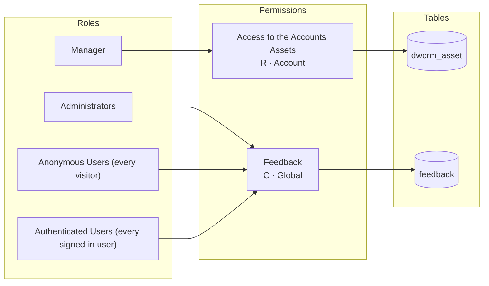

# PageLensPermissionTestEDM - site-43a00

<!-- Generated by pageslens from the site configuration. Do not edit by hand; run `pageslens docs` again. -->

- 4 web roles, 3 table permissions (2 grant access) on 2 tables
- Web API enabled on 0 tables

## Pages

- [Access matrix](access-matrix.md): which role can do what on which table
- [Web API surface](webapi.md): tables reachable through `/_api`, their fields and callers

## Roles, permissions and tables

