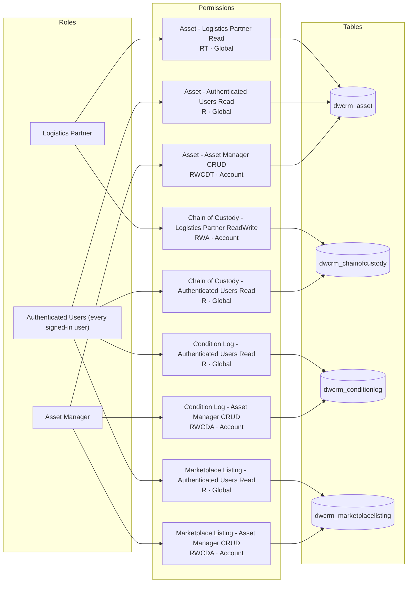

# EcoFlux

<!-- Generated by pageslens from the site configuration. Do not edit by hand; run `pageslens docs` again. -->

- 5 web roles, 9 table permissions (9 grant access) on 4 tables
- Web API enabled on 4 tables

## Pages

- [Access matrix](access-matrix.md): which role can do what on which table
- [Web API surface](webapi.md): tables reachable through `/_api`, their fields and callers

## Roles, permissions and tables

