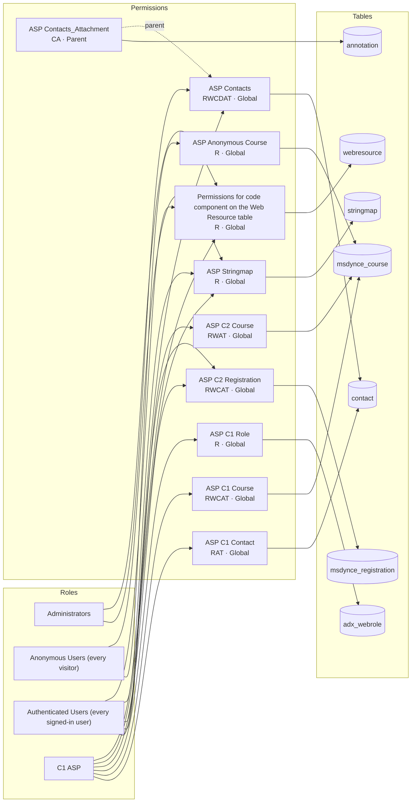

# PagesLensEDM2 - registrationsite-p7ero

<!-- Generated by pageslens from the site configuration. Do not edit by hand; run `pageslens docs` again. -->

- 4 web roles, 10 table permissions (10 grant access) on 7 tables
- Web API enabled on 5 tables
- 21 web pages, 12 open to anyone, 11 page access rules
- Left out as inactive: 1 table permission, 2 page access rules, 1 web page

## Pages

- [Access matrix](access-matrix.md): which role can do what on which table
- [Web API surface](webapi.md): tables reachable through `/_api`, their fields and callers
- [Pages](pages.md): who can read each page, from the page access rules

## Roles, permissions and tables

